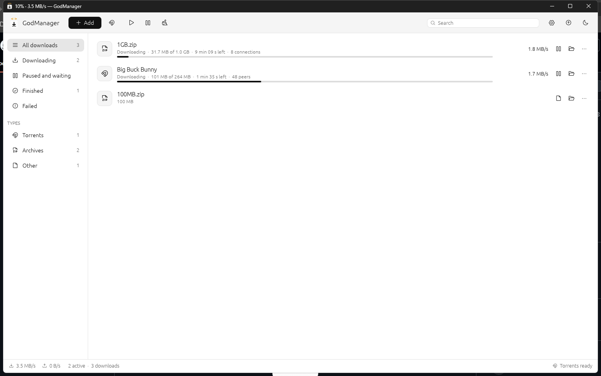

<p align="center"></p>

<h1 align="center">GodManager</h1>
<p align="center">A download manager in pure Rust: any file, and torrents. Local: no account, no cloud.</p>

<p align="center"></p>

## Download

Windows: get `GodManager-windows-x64.exe` from the [latest release](https://github.com/0XLUC4/GodManager/releases/latest).
It is a single file, nothing to install. It is not signed, so Windows SmartScreen may ask before running it.
New versions come through the Updates button: it downloads one and restarts on it.

## Features

- Any file over HTTP and HTTPS, with up to 16 connections per file. A connection left without work takes half of the biggest part still to fetch, so the end of a file goes as fast as its start.
- Pause and resume: the parts already written are kept, also when GodManager is closed or the computer restarts. A server that cannot send parts of a file is told apart: there a pause starts over.
- Torrents: magnet links, `.torrent` files and bare infohashes. DHT, trackers, peers on the local network, resume after a restart, a choice of the files to download, sharing with others once done (or not).
- A queue: how many files download at the same time, the others wait their turn.
- Speed limits for downloads and for what torrents send.
- The name of a file comes from the server, else from its address; a name already taken gets a number. A file downloads as `name.godpart` and takes its name once complete.
- A list with what each download does: speed, time left, connections or peers, a progress bar. Views by state (downloading, paused, finished, failed) and by type (torrents, video, music, pictures, documents, archives, programs), a search.
- Details of the selected download: the address, where it is saved, the parts of the file as a bar, the files of a torrent, what it has sent.
- SHA-256 of a finished file, and a field to paste the one its site gives: it says whether they match.
- Paste a link with Ctrl+V anywhere, or drop a `.torrent` file on the window. A `.torrent` file that finishes downloading starts as a torrent.
- Magnet links and `.torrent` files can open in GodManager (Settings): a click in the browser adds the torrent to the window already open.
- Ctrl+N add, Ctrl+O torrent file, Space pause or resume, Delete remove (with or without the files). The title of the window shows the progress and the speed.
- Dark and light theme. A note in the corner when a download ends, and the taskbar flashes when the window is behind.

Not there yet: FTP, a browser extension that catches downloads, a schedule.

## Build

```
cargo run --release
cargo test --workspace
```

Layout: `crates/core` (HTTP engine, torrents through librqbit, the list of downloads), `crates/app` (egui app).
The list and the settings are kept in `%APPDATA%\GodManager`.

## License

MIT OR Apache-2.0
